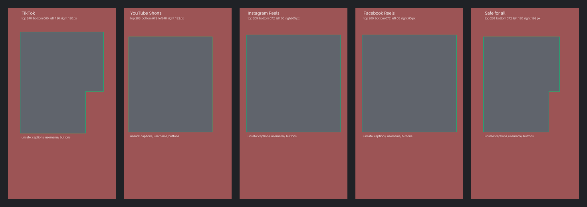

# short-form-safe-zones

Safe zones for vertical (9:16) video on TikTok, YouTube Shorts, Instagram Reels and Facebook Reels.

The app UI covers parts of every short: the caption and username at the bottom, the like and share buttons on the right, the tabs and progress bar at the top. Text or faces in those areas get hidden. This repo gives you the numbers, ready-made overlays and a small library to check a layout.



Red = unsafe. The green line is the edge of the safe area.

- `data/safe-zones.json`: the numbers, with a source link and a check date for each platform.
- `overlays/`: transparent 1080x1920 PNG and SVG overlays, one per platform plus `all`.
- `src/`: a zero-dependency TypeScript library (ESM).

Try it in the browser: [16:9 to 9:16 crop preview](https://clipx.io/tools/vertical-video-crop-preview).

## The numbers

Canvas 1080x1920. Margins are measured from each edge. Top and bottom percentages are a share of the height; left and right are a share of the width.

| Platform | Top | Bottom | Left | Right | Extra UI box | Basis |
| --- | --- | --- | --- | --- | --- | --- |
| TikTok | 240 px (12.5%) | 660 px (34.4%) | 120 px (11.1%) | 120 px (11.1%) | Right-side buttons: x 780, y 840, 180x1080 | Official template, measured |
| YouTube Shorts | 288 px (15%) | 672 px (35%) | 48 px (4.4%) | 192 px (17.8%) | none | Official |
| Instagram Reels | 269 px (14%) | 672 px (35%) | 65 px (6%) | 65 px (6%) | none | Official (percent) |
| Facebook Reels | 269 px (14%) | 672 px (35%) | 65 px (6%) | 65 px (6%) | none | Official (percent) |
| **Safe for all** | **288 px** | **672 px** | **120 px** | **192 px** | TikTok right-side buttons | Largest of the above |

The safe area for all platforms is the rectangle from (120, 288) to (888, 1248), minus the TikTok button column at x 780 and below y 840.

### Where the numbers come from

- **TikTok**: [TikTok Ads Help, Auction In-Feed Ads](https://ads.tiktok.com/help/article/tiktok-auction-in-feed-ads). TikTok gives the safe zone as an image file ("In-Feed-Standard Version LTR"), not as numbers. The image is labelled in 720x1280 units (160 top, 440 bottom, 80 each side, a right column 120 wide and 720 high). We measured the image to confirm the labels and scaled them by 1.5. TikTok says the zone also depends on caption length and on extras such as anchors.
- **YouTube Shorts**: [Google Ads Help, square and vertical video](https://support.google.com/google-ads/answer/9128498). The 1080x1920 diagram prints 288, 672, 48 and 192 px. The wider right margin leaves room for the like, dislike, comment and share panel ([Shorts ads guide](https://support.google.com/google-ads/answer/16041697)).
- **Instagram Reels**: [Meta Ads Guide, Instagram Reels](https://www.facebook.com/business/ads-guide/update/video/instagram-reels). Meta gives percentages: 14% top, 35% bottom, 6% each side. We convert to px and round up.
- **Facebook Reels**: [Meta Ads Guide, Facebook Reels](https://www.facebook.com/business/ads-guide/update/video/facebook-facebook-reels). Same percentages as Instagram Reels.

All sources were checked on 2026-11-07.

Things to know:

- These are the platforms' **ad** specs. The organic feed uses almost the same UI, and the platforms publish no separate organic spec. Long captions, music labels and stickers can cover more than this.
- Pixel values are rounded so the unsafe area never gets smaller than the official one.
- Some blogs quote other values (for example 20% or 40% at the bottom for Reels). We use the platform's own number when one exists.
- **Snapchat Spotlight is not included.** We found no official Snap page with numbers, and third-party guides disagree (150 px to 450 px at the bottom). A PR with an official source is welcome.

## Use in an editing app

Put the overlay PNG on the top track, above your video, at 1080x1920. Turn it off before you export.

- **Premiere Pro**: import `overlays/all.png`, drag it to the top video track and stretch it over the sequence.
- **DaVinci Resolve**: import the PNG to the media pool and place it on the top track. Disable the track before you render.
- **CapCut**: add the PNG as an overlay, set it to fill the 9:16 canvas and delete it before export.
- **Figma, Canva, After Effects**: use the SVG (`overlays/all.svg`) as a locked top layer.

Use `all.png` when you post one video to every platform. Use a platform file when you post to one.

## Use in JavaScript or TypeScript

```bash
pnpm add github:clipx-io/short-form-safe-zones
```

```ts
import { getSafeZone, safeForAll, isInSafeZone } from "short-form-safe-zones";

// Any 9:16 size. Default is 1080x1920.
const zone = getSafeZone("tiktok", { width: 720, height: 1280 });
zone.margins; // { top: 160, bottom: 440, left: 80, right: 80 }
zone.safeRect; // { x: 80, y: 160, width: 560, height: 680 }
zone.boxes; // [{ id: "right-actions", x: 520, y: 560, width: 120, height: 720, ... }]

// Safe on every platform.
safeForAll().margins; // { top: 288, bottom: 672, left: 120, right: 192 }

// Check a caption box (in the same pixel space as the size you pass).
isInSafeZone({ x: 200, y: 900, width: 500, height: 120 }, "all"); // true
isInSafeZone({ x: 200, y: 1500, width: 500, height: 120 }, "instagram-reels"); // false
```

Platform keys: `tiktok`, `youtube-shorts`, `instagram-reels`, `facebook-reels`, and `all`.

- `getSafeZone(platform, size?)` returns `{ key, name, size, margins, safeRect, boxes }`. It throws a `RangeError` if the size is not 9:16 (1% tolerance) or the key is unknown.
- `safeForAll(size?)` is the same as `getSafeZone("all", size)`.
- `isInSafeZone(rect, platform, size?)` is true when the rect is inside `safeRect` and does not overlap a box. Touching an edge is allowed.
- `data` is the raw JSON. You can also import the file: `short-form-safe-zones/safe-zones.json`.

## Development

```bash
pnpm install
pnpm test        # vitest
pnpm build       # regenerates src/data.ts, then tsc to dist/
pnpm overlays    # regenerates overlays/ and docs/preview.png (needs uv)
```

Edit `data/safe-zones.json` only. The library data and all overlays are generated from it, and a test fails if they drift.

To change a number, open a PR with a link to the platform's own page or file, and say whether the value is official or measured from a screenshot.

## License

- Code (`src/`, `scripts/`, `test/`): [MIT](LICENSE).
- Data and images (`data/`, `overlays/`, `docs/`): [CC BY 4.0](LICENSE-DATA). Use them anywhere, including in commercial work, and credit this repo.

Not affiliated with TikTok, Google, YouTube or Meta.

---

Maintained by the team at [ClipX](https://clipx.io) (clipx.io), an AI clipper that keeps captions inside these zones.
